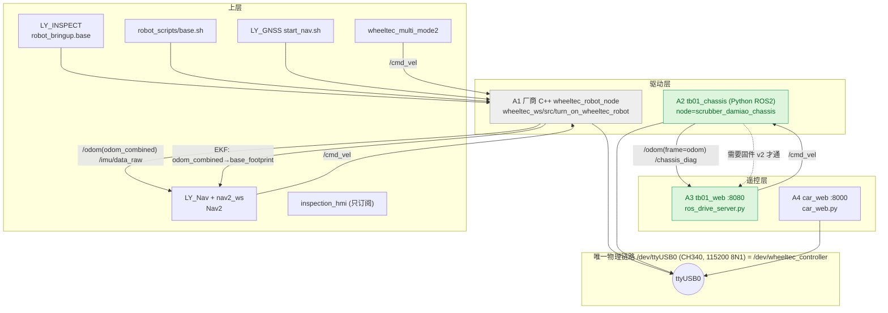

# RK3576（192.168.5.11）底盘 / 电机控制 全量盘点

> 调查时间：2026-10-22 15:35–15:50（主机本地时间 CST）
> 方式：只读。全部写操作只发生在 `/tmp`（调查脚本）与本地仓库 `.recon/`。
> 主机：RK3576 / Ubuntu 22.04 / kernel 6.1.118 / ROS 2 **只有 Humble** / Python 3.10.12 / pyserial 3.5
> 本次开机：2026-10-22 **15:18**（调查时 uptime 17 分钟）

---

## 1. 一句话总结

**主机上和"底盘/电机"直接相关的实现一共 4 套**：2 套底盘驱动（厂商 C++ `wheeltec_robot_node`、新写 ROS 2 `tb01_chassis`）+ 2 套网页遥控（`car_web` 直连串口 :8000、`tb01_web` 走 ROS :8080）；
另有 6 个"上层消费者"（LY_INSPECT / LY_Nav+nav2_ws / LY_GNSS / wheeltec_multi_mode2 / robot_scripts / inspection_hmi）通过 `/cmd_vel`、TF 或厂商 launch 间接用到底盘。

**当前在用的（也是最新的）是 `tb01_ws/src/tb01_chassis` + `tb01_web`（:8080）**，它俩是今天 13:21/13:46 才建的，用来替掉厂商的 `wheeltec_robot_node`。

**但 15:18 重启之后，一套都没在跑**：没有底盘节点、8000/8080 都没监听、`/dev/ttyUSB0` 没人占用。

---

## 2. 主机现状快照（15:35，只读）

| 项目 | 状态 |
|---|---|
| 底盘串口 | `/dev/ttyUSB0`（CH340 `1a86:7523`），`/dev/wheeltec_controller → ttyUSB0`（udev `99-chassis-ch340.rules`，2026-10-21 18:50 加） |
| 串口占用 | **无人占用**（`fuser` 空） |
| CAN | `can0` **DOWN**（主机侧不用 CAN，CAN 在 STM32 上） |
| 在跑的底盘相关进程 | **0 个**（`pgrep -af 'tb01\|chassis\|car_web\|ros_drive\|wheeltec'` 无输出） |
| 监听端口 | 22(ssh) 5900(vnc) 5555(adb) **8899**(gnss_web) 631(cups) 51000(trae) — **没有 8000 / 8080** |
| 唯一与机器人有关的常驻服务 | `ly-gnss-web.service`（systemd，enabled，running，:8899） |
| 开机自启里的底盘项 | **没有**。只有 `ly-gnss-web`(enabled) 和 `ly-gnss-driver`(disabled)；无 crontab；`/etc/rc.local` 里没有底盘内容 |
| ROS 环境 | `.bashrc` 依次 source `wheeltec_ws` → `LY_INSPECT` → `LY_Nav`，`ROS_DOMAIN_ID=7` |

---

## 3. 主表 A：真正碰底盘的两层（驱动 + 遥控）

| # | 路径 | 创建时间 | 最后修改 | 框架/语言 | 用途 | 通信 | 协议版本 | 在跑 | 自启 |
|---|---|---|---|---|---|---|---|---|---|
| A1 | `/home/smart/wheeltec_ws`（重点 `src/turn_on_wheeltec_robot`） | 2026-09-17 18:30:04 | 2026-09-21 18:24（代码 09-18 11:24） | **厂商原装** ROS 2 Humble，C++ (`wheeltec_robot.cpp`) | **底盘驱动**：`/cmd_vel` → 11B 速度帧；24B 遥测 → `/odom`、`/imu/data_raw`、`/PowerVoltage` | UART `/dev/wheeltec_controller` @115200 8N1 | Wheeltec 11B/24B（`0x7B..0x7D`，BCC=XOR）；**44B 诊断帧整帧跳过、不解析**；无 0x06 功能帧 | ❌ | ❌ |
| A2 | `/home/smart/tb01_ws`（`src/tb01_chassis`） | 2026-10-22 13:21:47 | 2026-10-22 14:26（已 colcon 重编） | **新写** ROS 2 Humble，纯 Python（ament_python） | **底盘驱动**（厂商节点的 drop-in 替代）：`/cmd_vel` → 11B；24B → `/odom` `/imu/data_raw` `/PowerVoltage`；**44B → `/chassis_diag`(JSON) `/chassis_diag_raw` `/diagnostics`** | 同上，`/dev/wheeltec_controller` @115200 | 11B/24B/44B/8B/19B 全解析；`DIAG_VERSION=2`、`DIAG_VERSION_MIN=1`、**`FUNC_FRAME_MIN_VERSION=2`** | ❌ | ❌ |
| A3 | `/home/smart/tb01_web` | 2026-10-22 13:46:20 | 2026-10-22 14:26 | 纯 Python 标准库（http.server + 手写 WebSocket）+ rclpy | **网页遥控（ROS 模式）**：浏览器 → `--WebSocket 30Hz-->` `ros_drive_server.py` → `--ROS /cmd_vel-->` `tb01_chassis`；状态取 `/odom` + `/chassis_diag` | **:8080**（默认 `0.0.0.0`）+ ROS 话题 | 自己不解析串口帧；靠 `diag.version` 判断能力 | ❌ | ❌ |
| A4 | `/home/smart/car_web` | 2026-10-22 12:55:46（文件 12:53） | 2026-10-22 12:54 | 纯 Python 标准库（同上，**不依赖 ROS**） | **网页遥控（直连模式）**：浏览器 → `car_web.py` **独占串口** → STM32；自带 6 档、缓启缓停、急停、`--sim` | **:8000** + 直接 `/dev/wheeltec_controller` @115200 | 11B/24B/44B 全解析；README 明确"协议版本 = 1"；**没有**"重新使能"能力 | ❌ | ❌ |

> A1 与 A2 是**同一件事的两代实现**：A2 的 README/协议注释逐条对照 A1 的字段、单位、BCC 写的（"drop-in 替换"）。
> A3 与 A4 是**同一套网页的两代实现**：A3 明显是从 A4 改的（同一个 `BridgeBase`/`SimBridge`/`WsClient`/`DriveServer` 骨架、同样的 `/api/state`、`/api/cmd`、`/api/reinit`），把"直连串口"换成了"发 `/cmd_vel`"。

---

## 4. 主表 B：上层消费者（不碰串口，但会驱动底盘）

| # | 路径 | 创建时间 | 最后修改 | 框架 | 用途 | 怎么用到底盘 | 在跑 | 自启 |
|---|---|---|---|---|---|---|---|---|
| B1 | `/home/smart/LY_INSPECT` | 2026-09-18 18:22:56 | git 最后提交 2026-09-23 18:04；FETCH 10-09 | ROS 2 Humble，C++/Python 混编，**git 仓库**（`robot-rebuild`，98 commits，首提交 2026-04-21，remote `yusongyi/robot.git`） | 巡检机器人整机栈（控制中心/导航/硬件/语音/云端） | `system_manager/system/robot_bringup.py` 里 `base` → `ros2 launch system_manager robot_base.launch.py` → 内含 `turn_on_wheeltec_robot.launch.py`（用 **A1**），串口 `/dev/wheeltec_controller` | ❌ | ❌ |
| B2 | `/home/smart/LY_Nav` | 2026-09-18 15:23:11 | git 最后提交 **2026-09-15 13:58**；工作区 2026-10-22 14:31 被整体刷新 + 14:59 fetch | ROS 2 Humble，C++/Python，**git 仓库**（master，52 commits，remote `shihaizhe/LY_Nav.git`） | 3D 定位 + Nav2 导航（MID360 / open3d_loc / mid360_nav_bridge） | 发 `/cmd_vel`、消费 `odom_combined → base_footprint` TF（**要求 A1 的 frame 名**） | ❌ | ❌ |
| B3 | `/home/smart/nav2_ws` | 2026-09-21 08:51:02 | 2026-10-19 18:21 | ROS 2 Humble，C++（navigation2 源码编译） | Nav2 上游源码构建 | 发 `/cmd_vel` | ❌ | ❌ |
| B4 | `/home/smart/LY_GNSS` | 2026-10-19 10:24:13 | 2026-10-19 21:27 | ROS 2 Humble，Python | 北斗 ATGM336H 驱动 + GNSS 网页可视化 | `start_nav.sh` 里 `ros2 launch turn_on_wheeltec_robot ...`（用 **A1**），**且 `ROS_DOMAIN_ID=0`** | 部分：`gnss_web_node` 在跑(:8899)；底盘**没**起 | **`ly-gnss-web.service` enabled + running**（`ly-gnss-driver` disabled） |
| B5 | `/home/smart/wheeltec_multi_mode2` | 2026-10-08 21:25:27 | 2026-10-10 20:28 | ROS 2 Humble，C++/Python | 多机编队（leader/follower，UDP 组播 `224.0.0.7:10000`） | `multi_avoidance.cpp` 发布 `cmd_vel` | ❌ | ❌ |
| B6 | `/home/smart/robot_scripts` | 2026-10-08 21:24:37 | 2026-10-10 17:47 | bash 包装器 | `base.sh` / `navigation.sh` / `localization.sh` / `task.sh` / `cloud_services.sh` | `base.sh` → `ros2 launch turn_on_wheeltec_robot turn_on_wheeltec_robot.launch.py`（**A1**） | ❌ | ❌ |
| B7 | `/home/smart/inspection_hmi_rk3576` | 2026-10-08 10:52:09 | 2026-10-09 15:39（二进制 `/build-rk-full/inspection_hmi`） | Qt/QML + C++，ROS 2 桥 | 大屏 HMI（点云/状态显示） | 只订阅，**没有 `/cmd_vel`**（全仓 grep 无） | ❌ | ❌ |

---

## 5. 非底盘（同目录里容易被误认，一并排除）

| 路径 | 结论 |
|---|---|
| `LY_Guide`（2026-10-08，Flask **:5000**） | 路径规划/地图标注的网页后台，不碰底盘 |
| `catkin_point_lio_unilidar`（2026-09-18） | **ROS 1 catkin 源码**（全机唯一 ROS1 的东西），没 build、没 devel，未参与运行 |
| `yolo_test` / `rosbags` / `inspection_data` / `voiceModel` / `frp_*` | 视觉/数据/穿透，与底盘无关 |
| `/home/smart/.git`（2026-09-18 14:08） | **空目录**（0 个文件），历史遗留 |

---

## 6. 时间线（先有什么、后加了什么）

**第一代：厂商栈（9 月中）**
- `2026-09-17 18:30` 拷入 `wheeltec_ws`（4.4 G；包内文件时间 2024-12 ~ 2026-04，所以是**厂商原装**）
- `2026-09-18 11:04~11:41` 本机改厂商代码：`base_serial.launch.py` / `turn_on_wheeltec_robot.launch.py` / `wheeltec_robot.cpp` / `package.xml` —— 给节点加了 `usart_port_name` 参数（原来串口写死）
- `2026-09-18 15:23` `LY_Nav`（导航） / `2026-09-18 18:22` `LY_INSPECT`（巡检整机，git 历史可追到 4 月）
- `2026-09-20 ~ 09-21` 调 `ekf.yaml`、`wheeltec_param.yaml`（`car_mode: senior_mec_bs`）
- `2026-09-21 08:51` `nav2_ws`（上游 nav2）
- `2026-09-21 16:21` `nohup.out` 里能看到厂商节点反复崩：`SerialException ... device disconnected` → 从这时起"串口抢用/掉线"就是常态

**第二代：LY 平台（10 月上）**
- `2026-10-08` `LY_Guide` / `wheeltec_multi_mode2` / `robot_scripts` / `inspection_hmi_rk3576`
- `2026-10-09 ~ 10-10` 编队调试（`formation.yaml` 注释里写着"5.11=robot7，domain 7"）
- `2026-10-19` `LY_GNSS` + **仅有的两条 systemd**（`:8899` 网页）

**第三代：达妙 DM-H65 改造（10-21 ~ 10-22，今天）**
- `2026-10-21 18:50` `/etc/udev/rules.d/99-chassis-ch340.rules`（普通 CH340 也能叫 `wheeltec_controller`）
- `2026-10-21 19:24` 仓库里开始做 `tools/car_web`（commit `172fa4b` "以达妙 web_driver 为基础, 控制路径改为 串口→STM32→CAN"）
- `2026-10-22 12:50` 起了一次**厂商节点** → 12:51 崩（`exit code -6`）
- `2026-10-22 12:53` `car_web` 定稿 → `12:55` 部署到 `/home/smart/car_web`
- `2026-10-22 13:21` **`tb01_ws` 建成**（`tb01_chassis` 首版，13:21 就编译了）
- `2026-10-22 13:22 / 13:23 / 13:25` 连起 3 次 `tb01_chassis`；13:25 那次跑了 33 分钟
- `2026-10-22 13:46` **`tb01_web` 建成**
- `2026-10-22 13:49` 有人又起了**厂商节点** → 3 秒后被 `tb01_chassis` 抢串口打死（见 §8 冲突）
- `2026-10-22 13:58 / 13:59 / 14:04 / 14:07` 又起 4 次 `tb01_chassis`（都在调）
- `2026-10-22 14:22` 固件 `main.c` 加 **v2 功能帧（0x06 重新使能）+ 上电后 10 s 补使能**，`STATUS_VERSION 1→2`；`14:32` Keil 重新编译（`Listings/scrubber.map`、`.uvguix` 全刷）——**这些改动至今未提交**（`git status` 里 `M firmware/.../main.c`）
- `2026-10-22 14:26` `tb01_chassis` 大改（`node.py`/`protocol.py`/`core.py`/`selftest.py`/`check_serial.py`/yaml）并重编译；`tb01_web` 同步更新；**同一时刻** `LY_Nav` 工作区被整体刷新（14:31），14:59 又 fetch 一次
- `2026-10-22 14:26:46` 最后一次起 `tb01_chassis`；**14:32:33 之后 STM32 一个字节都不再发**（节点日志：`底盘串口 2041.5s 没收到任何帧`）
- `2026-10-22 15:18` 主机重启 → 之后什么都没起

---

## 7. 关系图



**文字版依赖**
```
浏览器 ─┬─ :8000 car_web.py ───────────[独占串口]──────────┐
        └─ :8080 ros_drive_server.py ─/cmd_vel→ tb01_chassis ─┤
                                                                ├→ /dev/ttyUSB0 ─→ STM32 ─CAN 1Mbps→ 左/右 DM-H65
厂商 wheeltec_robot_node ────────────[独占串口]──────────────┘
   ↑ 被 robot_scripts/base.sh、LY_INSPECT(robot_base)、LY_GNSS(start_nav.sh)、Nav2(/cmd_vel)、编队(/cmd_vel) 调用
```

**替代关系一句话**：`tb01_chassis` 替 `wheeltec_robot_node`（同串口、同 11B/24B 协议，多的本事是解析 44B 诊断 + 主动零速保活 + 主机侧使能）；`tb01_web` 替 `car_web`（从"独占串口"改成"走 ROS"）。

---

## 8. ★ 冲突清单

### 8.1 串口（只有一个，四方抢）
`/dev/ttyUSB0` = `/dev/wheeltec_controller`，**独占**。会抢它的：
1. `wheeltec_robot_node`（A1）
2. `tb01_chassis`（A2）
3. `car_web.py`（A4，`import serial` 直接开）
4. `tb01_check_serial`（诊断工具）

**今天已经真打过一次**（日志实证）：
- `13:25:30` `tb01_chassis` 占着串口
- `13:49:09` 又起 `wheeltec_robot_node` → `13:49:11` tb01 报 `串口读异常: device reports readiness to read but returned no data (device disconnected or multiple access on port?)`
- `13:49:12` 厂商节点 `exit code -6`（`SerialException` 崩）
- 这正是 `nohup.out`（9-21）里那个反复出现的崩法

### 8.2 端口
| 端口 | 谁 | 冲突 |
|---|---|---|
| 8000 | `car_web`（A4） | 与 8080 不冲突；但**和 `tb01_web` 同时开时，两个前端都会发 `/cmd_vel`/写串口**，实际不可能共存（car_web 抢串口会让 A2 掉线） |
| 8080 | `tb01_web`（A3） | 仓库里旧的 `tools/chassis_web.py` 默认也是 8080（**该文件没部署到主机**，但如果哪天拷上来就撞） |
| 8899 | `gnss_web_node`（systemd 常驻） | 不冲突，但见 8.3 |
| 5000 / 8088 | `LY_Guide` / `LY_Nav/scripts/run_map2d_web.sh` | 与底盘无关，仅提醒 |

### 8.3 ROS_DOMAIN_ID 三套不一致
| 来源 | 值 |
|---|---|
| `~/.bashrc` | **7** |
| `robot_scripts/launch_common.sh` | `${ROS_DOMAIN_ID:-6}`（实际继承 7，所以是 7） |
| `LY_GNSS/start_nav.sh` | **0** |
| `ly-gnss-web.service` / `ly-gnss-driver.service` | **未设置 → 0** |

→ 现在跑着的 **`:8899` 网页在 domain 0**，而你在 ssh 里（domain 7）起的导航/底盘它看不见；`start_nav.sh` 起的底盘也在 0，和 `robot_scripts`（7）起的 Nav2 互相看不见。**这是"起了但互相不通"的高发点。**

### 8.4 协议版本对不上（核心）
| 项 | 值 |
|---|---|
| `protocol.py` | `DIAG_VERSION=2`、`DIAG_VERSION_MIN=1`、`FUNC_FRAME_MIN_VERSION=2` |
| 板上固件 `STATUS_VERSION` | **1**（已提交的那版；v2 只存在于 14:22 的**未提交工作区**里，`git diff` 可见） |
| 结果 | "上位机电机使能"整条链路被版本门槛挡住（见 §9） |

> 佐证：`car_web/README.md`（今天 12:53）在"上车前必须确认"里写 `版本=1`；`tb01_chassis/README.md` 开头写"当前固件是 44B 诊断帧 v1"；今天的 ROS 日志里**从没出现** `底盘固件 v2: 支持上位机电机使能` 这行（只有收到 v≥2 才会打）。
> 另外我核对了固件 `Status_Send()`：BCC 是 `XOR(f[0..41])`，与主机 `frame_valid()` 完全一致 —— 所以**不是**解析不一致导致读不到版本，就是板上确实还是 v1。

### 8.5 话题 / TF 重叠
- 两个驱动都发 `/odom`、`/imu/data_raw`、`/PowerVoltage` → 同时跑会互相覆盖（但串口独占，实际跑不起来）。
- **frame 名不一致**（换驱动时最容易踩）：
  - 厂商 A1：`/odom` 的 `frame_id = odom_combined`（`base_serial.launch.py`），TF 由 EKF 发 `odom_combined → base_footprint`
  - 新 A2：`/odom` 的 `frame_id = odom`，默认 `publish_tf: false`
  - `wheeltec_ws/.../ekf.yaml` 里 `world_frame: odom_combined`、`odom0: odom`
  → 若把 A2 塞进 `LY_Nav` 那套 EKF 里，`/odom` 的 frame 名要改成 `odom_combined`（或改 EKF），否则 TF 链断。

---

## 9. ★ 版本门槛：v1 固件下"电机使能"到底被谁挡住

`FUNC_FRAME_MIN_VERSION = 2`（`protocol.py:63`）是**主机侧**的开关，`node.py` 用它挡了 4 条路径：

| 入口 | 代码 | v1 时的行为 | 用户看到什么 |
|---|---|---|---|
| 话题 `/chassis_motor_reinit`（`std_msgs/Empty`） | `node.py:209` → `_request_reinit()` `190-197` | `return False`，**一帧都不发** | 只有一条 10 s 节流 `WARN`：`上位机使能命令需要底盘固件 v2+，当前 v1（需升级固件；临时办法：复位 STM32）` |
| 服务 `/chassis_reinit_motors`（`std_srvs/Trigger`） | `node.py:213-223` | `success=False` | 返回 `未发送：当前底盘固件 v1 不支持上位机使能（需 v2+），或请求过于频繁` |
| **自动补救** `_auto_reinit()` | `node.py:245-246`：`if self._firmware_version < 2: return` | **完全静默** —— 无日志、无重试、无返回值 | **什么都没有**（这就是"静默拒绝"） ← 真正的坑 |
| `core.send_func(0x06)` | `core.py:183-199` | 永远不会被调用（上面三层都挡住） | — |
| `check_serial --reinit` | `check_serial.py:72-73` | 打印 `!! 底盘固件 v1 不支持上位机使能` 并不发 | 终端提示 |
| `tb01_web`「重新使能电机」按钮 | 后端 `ros_drive_server.py:307` `reinit_supported = version>=2`；前端 `drive.js:248-260` | 按钮 `disabled`，提示"请复位 STM32 或升级固件 v2" | 前端**做对了**（但注意 `POST /api/reinit` 只判断"publish 成功"，会回 `reinit_sent: true`，若绕过 UI 直接调接口会误以为发了） |

**后果（为什么这可能是"车不动"）**：
1. DM 驱动器上电默认**失能**，只能由 STM32 发使能帧；老固件**只在 STM32 自己启动时发一次**（3 次重试、400 ms 预算），整车断电重启时 STM32 常比驱动器先起来 → 使能帧静默丢掉 → 车一直不动、而诊断 `ERR` 还是 0（失能）。
2. v1 固件**也没有**"上电后 10 s 补使能"的对策 —— 那是 `14:22` 才写进工作区（未提交、未烧录）的东西。
3. 所以：**v1 + 驱动器掉使能 = 软件侧完全无解**，只能 `复位 STM32` / 整车断电重启。这正是今天 README 里反复写"临时办法：复位 STM32"的原因。
4. 测试还骗人：`selftest.py:83` 的假固件直接 `body[30] = p.DIAG_VERSION`（=2），`selftest.py:244` 断言"诊断帧版本 v2" → **自测全绿，但真机是 v1**，这个门槛在自测里永远走不到。

**今天下午的实际现象（日志实证，供定位用）**：
- 13:22–14:07 六次启动，串口都**打开成功**、能收到 24B 遥测；
- 但只要下发过非零速度，就周期性出现 `WARN 底盘 Flag_Stop=1（已下发非零指令但轮速正解为 0）`（固件 `f[1] = (g_eff_vx==0 && g_eff_wz==0)`，即"有效命令=0"）；
- 日志里**从未出现** `驱动器失能: err=[...]`，也**从未出现** `底盘固件 v2`；
- 14:32:33 之后 STM32 **彻底不发帧**（`底盘串口 2041.5s 没收到任何帧`），到 15:18 重启为止。14:32 正好是 Keil 重编译那个时间点（`Listings/scrubber.map`、`.uvguix` 时间戳），**高度怀疑那一刻刷了固件但板子没正常跑起来**（也可能只是断了电/拔了线）。

> 结论分三层，别混：
> ① **现在车不动的最直接原因**：重启后什么都没起，`/cmd_vel` 和串口都不存在；
> ② **起来了也不动的原因**：v1 固件 + 驱动器失能时，主机没有任何手段补救（§9 那条静默分支）；
> ③ **14:32 之后的新问题**：STM32 连遥测都不发了，需要现场确认板子是否在跑（LED PB9 是否 2 Hz/5 Hz 闪、是否烧的是刚编的 v2）。

---

## 10. 建议（只建议，未做任何改动）

**保留（当前主线）**
1. `tb01_ws/src/tb01_chassis` —— 唯一能看 44B 诊断、唯一有主动零速保活/超时刹车的驱动。**建议提交进仓库**（现在只存在于主机的 `/home/smart/tb01_ws`，仓库里没有，主机挂了就没了）。
2. `tb01_web`（:8080）—— 与 A2 配套。同样建议入库。
3. `car_web`（:8000）—— 当"**不装 ROS 也能开车**"的应急通路留着，很值；但要写清"和 A2 二选一"。
4. `wheeltec_ws` —— 别删。`LY_Nav` / `LY_INSPECT` / `LY_GNSS` / `robot_scripts` 全指望它的 `turn_on_wheeltec_robot`、URDF、EKF 参数。

**优先处理（按性价比）**
1. **把固件 v2 烧进去**（`STATUS_VERSION=2` + 0x06 功能帧 + 上电 10 s 补使能）。这是唯一能让"车不动"有软件解的办法；现在它只是工作区里未提交的 diff。
2. 烧完再确认：`ros2 topic echo /chassis_diag --once` 里 `version` 应为 2；`/chassis_reinit_motors` 服务应返回 `success: true`。
3. 把 `tb01_web` 的 `/api/reinit` 改成"看 `diag` 里 err 变 [1,1] 才算成功"（现在只判断 publish 成功）。
4. `selftest.py` 增加一档"固件 v1 仿真"，专门测版本门槛分支，别再自测全绿实机全废。
5. 统一 `ROS_DOMAIN_ID`（建议全机 7），包括两条 systemd（加 `Environment=ROS_DOMAIN_ID=7`）和 `LY_GNSS/start_nav.sh`。
6. 换驱动到 Nav2 时，把 `tb01_chassis.yaml` 的 `odom_frame` 改成 `odom_combined`（或改 EKF 的 `world_frame`），否则 TF 断。

**建议清理（先确认没人用，再动）**
1. `/home/smart/Desktop/tt` —— 一段 `rviz2` 段错误的粘贴，无意义。
2. `/home/smart/cap_%d`（0 字节）、`odom_combined===`、`utm===`、`/home/smart/.git`（空目录）—— 都是误操作产物。
3. `inspection_hmi_rk3576_deploy_20261009_final_152710` / `inspection_hmi_test_20261010` / `inspection_hmi_*_*.tar.gz` —— 三个解包副本（67 M + 74 M + 84 M），只留最新的一个即可（约省 150 M）。
4. `ros-humble-bond*.deb`（166 K，9 月装完就多余）。
5. `catkin_point_lio_unilidar`（ROS1，45 M，从未编译、没 source 进任何环境）—— 确认不用后可删。
6. `/home/smart/tb01_web/static/style.css`（13.6 K，13:46 版本，`drive.html` 用的是 `drive.css`）—— 疑似 car_web 带过来的残留。

**别做的事**
- 别同时起 A1/A2/A4（串口只有一个）。
- 别在没停 A2 的情况下 `ros2 launch turn_on_wheeltec_robot ...`（今天 13:49 崩过一次）。

---

## 11. 只读复核（主机没被改动）

| 检查 | 结果 |
|---|---|
| 工作区文件改动（`find /home/smart -newermt '2026-10-22 15:30' -maxdepth 2`） | 只有 `LY_Nav/.git`、`LY_INSPECT/.git` 两个**目录 mtime** 变化（被我 `git status` 刷新索引导致），**没有任何源码/配置被改动** |
| `git -C LY_Nav status` | 干净（`0007e64`，2026-09-15） |
| `git -C LY_INSPECT status` | 只有 1 条 ` M scripts/colcon_build.sh` —— **调查前就存在**（该文件 mtime 2026-09-23 17:56，与本会话无关） |
| 我产生的文件 | 只在 `/tmp/*.sh`（调查脚本）和本地仓库 `D:\github\TB01-CAN-USART\.recon\` |
| 进程 / 服务 / 端口 / 串口 | 与调查开始时一致：没有启动或停止任何东西，`/dev/ttyUSB0` 仍无人占用，`ly-gnss-web` 保持原状 |
