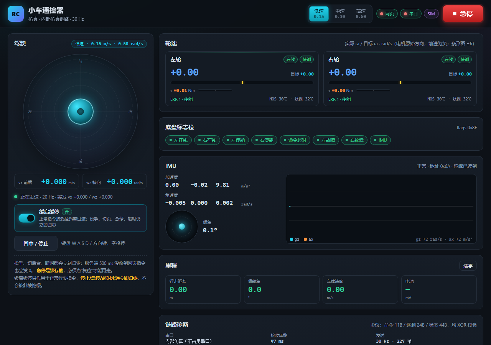

# 小车遥控器 Web（RK3576 → STM32 → 达妙 DM-H65）

浏览器里的虚拟摇杆遥控器。它**不再直连 USB-CAN**，而是由 RK3576 上的这一个进程
独占 `/dev/wheeltec_controller`，按 STM32 桥的串口协议收发：

```
浏览器（手机/电脑）
   │  WebSocket：20 Hz 指令 + 20 Hz 状态
   ▼
car_web.py（本进程，唯一碰串口的一线程）
   │  115200 8N1：11 字节命令帧 / 收 24+44 字节帧
   ▼
STM32 桥（firmware/stm32-chassis）── CAN 1 Mbps ──> 左/右 DM-H65 轮毂电机（ID 1/2）
```

Web 端只用标准库 `http.server` + 自己实现的极简 WebSocket，**不依赖 FastAPI/uvicorn**。



> 截图在 `--sim` 模式下用 headless Chrome 拍的（低速档、缓启缓停默认开）。

---

## 1. 文件

| 文件 | 作用 |
|---|---|
| `car_web.py` | 后端：串口收发（单线程）、帧同步/BCC 校验、解码、WebSocket 广播、HTTP API、安全状态机、`--sim` 仿真 |
| `static/index.html` | 页面结构（驾驶区、轮速、flags、IMU、里程、链路诊断） |
| `static/style.css` | 深色卡片样式，无外网依赖，移动端适配 |
| `static/app.js` | 摇杆/键盘输入、20 Hz 指令发送、状态渲染、IMU 波形、急停与页面生命周期 |
| `selftest.py` | `--sim` 离线自测：33 项断言（含方向、斜坡、停止语义、真实浏览器） |
| `README.md` | 本文（启动、协议、安全、上车核对） |

`--sim` 模式**不打开任何串口**，不需要 pyserial；真机模式才 `import serial`。

---

## 2. 依赖与启动

- Python 3.10+（Windows 上用 3.12.8 自测；RK3576 上是 3.10）
- `pyserial`（真机必需；RK3576 已装）
- 不需要 NumPy / FastAPI / uvicorn / node

```bash
cd tools/car_web

python3 car_web.py --sim          # 仿真：不占串口，UI/API/安全逻辑全跑
python3 car_web.py                # 真机：/dev/wheeltec_controller @115200
python3 car_web.py --port 8001    # 8000 被占用时换端口
```

浏览器打开 `http://<RK3576_IP>:8000`（本机 `http://127.0.0.1:8000`）。
启动时终端会打印三个地址，其中局域网地址就是给手机用的那个。

| 参数 | 默认 | 说明 |
|---|---|---|
| `--host` | `0.0.0.0` | 监听地址 |
| `--port` | `8000` | 监听端口（`tools/chassis_web.py` 占的是 8080，避开） |
| `--serial` | `/dev/wheeltec_controller` | 串口设备；udev 已建好该符号链接 |
| `--baud` | `115200` | 8N1 |
| `--sim` | 关 | 内部仿真，产生与固件逐字节同格式的帧 |
| `--tx-hz` | `30` | 命令帧频率，只允许 20~50（固件看门狗 800 ms） |
| `--verbose` | 关 | 每秒一行统计 + HTTP 访问日志 |

建议在 RK3576 上先跑 `python3 car_web.py --sim` 确认页面和手机都能打开，再换成真机。

### 可选：systemd 开机自启

```ini
[Unit]
Description=car_web remote
After=network.target

[Service]
# 按实际路径改这两行
WorkingDirectory=/home/smart/TB01-CAN-USART/tools/car_web
ExecStart=/usr/bin/python3 car_web.py
Restart=always
RestartSec=2
User=smart

[Install]
WantedBy=multi-user.target
```

> 注意：`User=smart` 必须能读写 `/dev/ttyUSB0`，否则串口打不开（日志里会写原因）。

---

## 3. 界面怎么用

- **摇杆**：圆形区域，上下 = `vx`（前/后），左右 = `wz`（右推右转）。
  鼠标按住拖动、触摸拖动都行（Pointer Events）。中心有 10% 死区防手抖。
- **档位**：右上角 低速/中速/高速，同时限制 `vx` 和 `wz`（见下表），
  当前上限显示在驾驶卡的胶囊里。键盘 `1/2/3` 也能切。
- **急停**：右上角大红按钮。按下立即发 0 并**锁存**，之后无论怎么推摇杆都只发 0；
  必须点“复位”才能再动，且复位后要重新推摇杆（不会自己恢复上一目标）。
- **键盘**：`W A S D` / 方向键，空格 = 立即停。桌面调试很方便。
- **缓启缓停**：驾驶卡里的滑动开关，**默认开**。开启时正常行驶指令按
  `vx 1.0 m/s²`、`wz 4.0 rad/s²` 的斜率逼近目标（低/中速档约 100~300 ms 到位），
  开关会亮起并在斜坡推进时显示“斜坡中”；关闭后恢复旧的阶跃行为。
  **松手、切页、失焦、急停、心跳超时仍然立即发 0，不走斜坡**（见 §4）。
- **轮速条**：实心条 = 实际 ω，黄色竖线 = 目标 ω，满量程 ±6 rad/s（箭头贴边表示超出）。
- **flags**：8 个中文字段，绿=正常、红=异常（在线/使能/命令超时/故障/IMU）。
- **IMU**：六轴数值 + 水平泡（由 ax/ay 算）+ gz/ax 波形（最近 7.5 s）。
- **里程**：用**实际** `vx/wz` 积分（不是命令值），可清零；偏航角折到 ±180°。

| 档位 | vx 上限 | wz 上限 |
|---|---|---|
| 低速 | 0.15 m/s | 0.50 rad/s |
| 中速 | 0.30 m/s | 0.75 rad/s |
| 高速 | 0.50 m/s | 1.00 rad/s |

硬上限永远存在：`|vx| ≤ 0.5 m/s`、`|wz| ≤ 1.0 rad/s`（服务端再夹一次，不信前端）。

### 3.1 方向约定（改符号前先看这里）

固件逆解是：

```text
v_left  = vx - wz * TRACK/2
v_right = vx + wz * TRACK/2
```

所以 **`wz > 0` = 左轮慢/右轮快 = 车向左转（逆时针）**；
“右推摇杆 = 右转”就必须发 **`wz < 0`**。

- 前端 `static/app.js` 顶部有唯一取反点：

  ```js
  const WZ_CMD_SIGN = -1;
  // steerWz(右推量, 档位上限) = WZ_CMD_SIGN * 右推量 * 上限
  ```

  摇杆和键盘 `D/→` 都调用 `steerWz()`，不要再在别处写裸负号。
  以后要反方向，只改 `WZ_CMD_SIGN` 这一处。
- **后端 `car_web.py` 不再二次取反**：它收到的是协议值，`build_cmd_frame()`
  原样编码成 11 字节帧。否则会双重取反，右推变左转。
- **遥测/轮速显示保持实际值**：24 字节帧的 `wz`、44 字节帧的左右轮 `ω`
  都是固件按实际反馈算出来的，**不在显示层翻转**；界面上的符号就是车体真实方向。
- `vx` 的前进方向由固件 `DM_DIR_SIGN = -1` 负责（前进为正），网页端不动它。

---

## 4. 安全设计（三层，任一层失效都还能停）

| 层 | 触发 | 行为 |
|---|---|---|
| 浏览器 | 松手 / 切后台（visibilitychange）/ 页面关闭（pagehide）/ 窗口失焦 | 立刻发 `vx=0,wz=0`；断网时停止发送 |
| 服务端 | 500 ms 没收到网页指令（WebSocket 断开也会立刻清） | 只发 0；`cmd.reason = timeout` |
| 服务端 | 急停 | 锁存，只发 0，直到 `/api/estop/reset` |
| 服务端 | 任何指令 | 先按档位、再按 ±0.5 / ±1.0 硬夹；NaN/Infinity 直接归零 |
| 服务端 | 缓启缓停开启时的**正常行驶**指令 | 按 `vx 1.0 m/s²` / `wz 4.0 rad/s²` 斜坡逼近目标（默认开） |
| 服务端 | 缓启缓停开启时的**停止** | **不走斜坡**：目标为 0 / 急停 / 超时都在下一拍直接归零 |
| STM32 | 800 ms 没收到合法命令帧（固件） | 目标清零（不使能、不失能，保持零速） |

其他实现细节：

- 串口由**一个线程**（`LinkWorker`）顺序做 `read → 组帧 → write`，不存在两个线程抢同一个 fd；
  POSIX 上用 `exclusive=True`（TIOCEXCL）打开，尽量阻止别的进程同时读。
- 串口打不开**不退出进程**：HTTP/WS 照常提供，每秒重试一次，`/api/state` 里能看到原因，
  这样现场可以先开网页排查接线。
- WebSocket 断开时只有“最后发指令的那个客户端”会把目标清零；
  开第二个标签页只看状态，不会把正在开的车弄停。
- **急停锁存期间收到的指令只计数、不生效**（目标保持 0、时间戳清零），
  复位后不会把锁存期间最后一帧指令“放出来”，必须重新推摇杆。
- 浏览器 20 Hz 持续发（包括 0），既是控制也是心跳；后台标签页被浏览器节流后
  自然超过 500 ms，服务端会归零 —— 这是期望行为。

### 4.1 缓启缓停为什么放在后端

斜坡在 `CarHub.step_output()` 里推进，只有 `LinkWorker` 这个串口线程按 20~50 Hz
调用它；`snapshot()` / HTTP 线程只读，不积分。这样做的好处：

1. 前端断网/卡顿/标签页被节流时，后端仍按自己的节拍平滑过渡，不会因为
   网页 20 Hz 抖动而一冲一冲；
2. 与 500 ms 心跳、800 ms 固件看门狗在同一层，不会出现“网页还在斜坡、
   服务端已经超时归零”的互相打架；
3. 前端只负责开关状态，控制律只有一份。

**停止不进斜坡**是硬性安全语义：`step_output()` 里只要满足下面任一条件，
就把 `out_vx/out_wz` 直接置 0，不按斜率下降：

- `reason == "estop"`（急停锁存）；
- `reason == "timeout"`（500 ms 没收到网页心跳）；
- 目标恰好是 `(0, 0)`：松手、切页、失焦、回中、`/api/stop` 都会让网页发 0，
  目标为零就按“停”处理。

所以“缓启缓停”只影响**正常行驶指令的加速/减速过程**（例如从 0.1 推到 0.3，
或用户自己慢慢把摇杆收回），绝不会把任何一条安全停止路径变慢。
急停/超时目标被清零后，再给新指令会从 0 重新开始斜坡。

> 没有登录/鉴权。**只放在可信局域网**，不要把端口映射到公网。

---

## 5. 串口协议（与 `firmware/stm32-chassis/user/main.c` 核对过）

### 5.1 命令帧（上位机 → STM32，11 字节，大端）

| 字节 | 含义 |
|---|---|
| 0 | `0x7B` 帧头 |
| 1 | `0`（AutoRecharge，固件忽略） |
| 2 | `0`（SecurityPLY，固件忽略） |
| 3..4 | `vx` int16 BE，mm/s |
| 5..6 | `vy` int16 BE，恒 0（差速车没有横向自由度） |
| 7..8 | `wz` int16 BE，mrad/s |
| 9 | `BCC = XOR([0..8])` |
| 10 | `0x7D` 帧尾 |

按 20~50 Hz 持续发（默认 30 Hz）。STM32 的 `CMD_TIMEOUT_MS = 800`，
超时就 `g_eff_vx=0/g_eff_wz=0`，但**保持使能**（零速主动刹住比失能滑行安全）。
本程序用 500 ms 心跳先归零，所以正常情况看不到固件超时。

### 5.2 上行 24 字节主遥测帧（STM32 → 上位机，20 Hz）

| 字节 | 含义 |
|---|---|
| 0 | `0x7B` |
| 1 | `Flag_Stop`：1 = 当前命令为停止（超时也按停止算） |
| 2..3 | 车体 `vx` int16 BE，mm/s（由左右**实际**轮速正解） |
| 4..5 | `vy`，恒 0 |
| 6..7 | 车体 `wz` int16 BE，mrad/s（实际轮速差速正解） |
| 8..9 / 10..11 / 12..13 | IMU `ax/ay/az` int16 BE，m/s² = raw / **1671.84**（±2g 量程） |
| 14..15 / 16..17 / 18..19 | IMU `gx/gy/gz` int16 BE，rad/s = raw × **0.00026644**（±500 dps） |
| 20..21 | 电池 uint16 BE，mV —— **新底盘无采样，恒 0**（界面显示“—”） |
| 22 | `BCC = XOR([0..21])` |
| 23 | `0x7D` |

> `vx/wz` 是**车体系**：前进为正。IMU 原始值在固件里已从 ±16g/±2000dps 换算到
> 上位机约定的 ±2g/±500dps，所以这里的系数不能改。

### 5.3 上行 44 字节状态帧（STM32 → 上位机，20 Hz）

| 字节 | 含义 |
|---|---|
| 0 | `0x7E` |
| 1 | flags（见下） |
| 2..3 / 4..5 | STM32 **最近一次收到的** vx / wz（mm/s、mrad/s，不是超时后的 0） |
| 6..7 / 8..9 | 左/右**实际** ω ×100，rad/s（电机原始方向） |
| 10..11 / 12..13 | 左/右**目标** ω ×100，rad/s（逆解+限幅后的最终值） |
| 14..15 / 16..17 | 左/右扭矩 ×100，Nm |
| 18 / 19 | 左/右 ERR：**0=失能、1=使能都算正常**，其它为故障 |
| 20 / 21 | 左/右 MOS 温度 ℃ |
| 22 / 23 | 左/右线圈温度 ℃ |
| 24..25 / 26..27 | 左/右位置 ×100，rad |
| 28 / 29 | CAN 发送失败计数 / 反馈帧总数（饱和 8 位） |
| 30 | 协议版本 = 1 |
| 31 | IMU 诊断码（0 正常 / 1 SCL 拉不高 / 2 SDA 拉不高 / 3 总线死 / 4 无应答 / 5 读出错） |
| 32..33 / 34..35 | 左/右反馈年龄 ms（0xFFFF = 从没收到） |
| 36..37 | tick 低 16 位 |
| 38 | IMU 扫描到的 I2C 地址（0 = 没扫到） |
| 39 | IMU 体检：bit0 版本 / bit1 陀螺 / bit2 磁力 / bit7 = 读到过非零角速度 |
| 40 | IMU 版本号 |
| 41 | 启动阶段：0 启动中 / 1 正常 / 2 CAN 初始化失败 / 3 IMU 从未读到 / 4 两者都失败 |
| 42 | `BCC = XOR([0..41])` |
| 43 | `0x7D` |

flags 位：

| 位 | 含义 |
|---|---|
| bit0 / bit1 | 左 / 右在线 |
| bit2 / bit3 | 左 / 右使能 |
| bit4 | 命令超时（800 ms） |
| bit5 / bit6 | 左 / 右故障（ERR > 1） |
| bit7 | IMU 最近一次读取成功（旧协议是 bit2/3，现在被使能位占用了） |

> **方向**：固件里 `DM_DIR_SIGN = -1`（实测发 `vx=+0.1` 时两轮倒转，所以整体取反）。
> 因此 44 字节帧里的 **ω 和扭矩是电机原始方向**：车前进时 ω 为负；而 24 字节帧的
> `vx/wz` 已乘过方向系数，前进为正。界面按这个约定显示（轮速卡上标注了“前进为负”）。
>
> 命令帧的 `wz` 是**协议值**：`wz > 0` 左转、`wz < 0` 右转。网页的“右推”在
> `static/app.js` 的 `WZ_CMD_SIGN = -1` 处转成负值；服务端和遥测都不再取反（§3.1）。
> 如果实车右推仍左转，先按 §8 检查左右电机 CAN ID/接线是否互换，不要在前端或
> 遥测显示层偷偷翻符号（那会让“实际值”和“指令值”对不上）。

### 5.4 帧同步与 BCC 的实现要点

1. **同步条件**：`上一字节 == 0x7D` 且 `本字节 ∈ {0x7B, 0x7E}` 才当成帧头。
   固件保证按 **先 24 字节、后 44 字节** 的顺序发，所以每个帧头前面都是上一个帧尾。
   单看当前字节会把数据区里的 `0x7B/0x7E` 误认为帧头，加前导约束后误判率大幅下降，
   剩下的靠“帧尾 + BCC”兜底。
2. **长度表**：`0x7B → 24`，`0x7E → 44`。凑够长度才校验。
3. **BCC**：`XOR(frame[0 .. len-3])` 必须等于 `frame[len-2]`，且 `frame[len-1] == 0x7D`。
   失败时**只丢第一个字节**，再从下一字节重新找“前导帧尾 + 帧头”，
   不需要清空缓冲，更不需要复位；丢字节数记在 `link.resync_bytes`，校验失败次数记在
   `link.bad_frames`，界面的“链路诊断”里能直接看到。
4. 跨 `read()` 的前导字节用一个 `prev` 字段保存，所以帧被拆在两次串口读里也能接上。
5. 解析器只用 1 KB 以内的 `bytearray`，**不假设一次 read 正好是一帧**。

`--sim` 模式产生的 24/44 字节帧也走同一个解析器，所以 BCC、帧同步、缩放系数
在 Windows 上就能验证，真机上只剩接线和方向要确认。

---

## 6. HTTP / WebSocket 接口

| 方法 | 路径 | 说明 |
|---|---|---|
| GET | `/` `/static/*` | 页面（UTF-8，无外网依赖） |
| GET | `/api/state` | 完整状态 JSON（~2.7 KB） |
| GET | `/status` | 纯文本，`curl` 直接看，不需要 jq |
| POST | `/api/cmd` | `{"vx":0.1,"wz":0.2}`，m/s、rad/s；也接受 `/api/stop` |
| GET | `/api/ramp` | 查询缓启缓停：`{"ok":true,"ramp":{...}}` |
| POST | `/api/ramp` | `{"on":true}` 开、`{"on":false}` 关；也接受 `enabled` / `1` / `0` / `"on"` / `"off"` |
| POST | `/api/gear` | `{"gear":"low"\|"mid"\|"high"}` |
| POST | `/api/estop` | 锁存急停 |
| POST | `/api/estop/reset` | 解除锁存（目标仍为 0） |
| POST | `/api/odom/reset` | 里程清零 |
| WS | `/ws` | 双向 JSON |

WebSocket 客户端消息：

```json
{"t":"cmd","vx":0.1,"wz":0.2}
{"t":"gear","gear":"mid"}
{"t":"ramp","on":true}
{"t":"estop"}
{"t":"estop_reset"}
{"t":"odom_reset"}
{"t":"ping"}
```

> `wz` 遵循 **§3.1 协议约定**：右转为负。网页摇杆已经按这个约定换算；
> 脚本直接调 API 时也要注意符号，不要和“驾驶意图（右为正）”混用。

服务端 20 Hz 推送 `{"t":"state", ...}`，字段与 `/api/state` 相同。
指令按 20 Hz 发即可；HTTP 客户端也能控制（`owner=0`），方便脚本自测。

`/api/state` 主要字段：

```text
sim, link{open,port,baud,error,tx_hz,tx_count,telemetry_count,status_count,
          bad_frames,resync_bytes,rx_age_ms}
cmd{vx,wz,tx_vx,tx_wz,target_vx,target_wz,reason,clamped,age_ms,has_client}
ramp{on,default_on,vx_acc,wz_acc,out_vx,out_wz,target_vx,target_wz,active,steps}
safety{estop,timeout_ms,vx_limit,wz_limit}
gear{key,name,vx,wz}
telemetry{vx,vy,wz,ax..gz,bat_mv,stop}
status{flags_raw,flags{},left{omega,target,torque,err,err_text,mos_temp,coil_temp,
        pos,fb_age_ms,online,enabled},right{...},cmd_vx,cmd_wz,imu_status_text,
        boot_stage_text,...}
odom{distance,yaw}
events[{t,msg}]
```

其中 `cmd.tx_vx/tx_wz` 与 `ramp.out_vx/out_wz` 是**斜坡后真正写串口**的值，
`cmd.target_vx/target_wz` 是夹取后的目标值；`ramp.active=true` 表示当前正在斜坡中。
关闭缓启缓停后 `tx_*` 会在下一拍直接等于 `target_*`。

---

## 7. 离线自测（`--sim`）

一条命令跑完（自动找空闲端口、自动启停 `car_web.py --sim`）：

```powershell
cd tools\car_web
python selftest.py                 # 需要 Edge/Chrome；没有就加 --no-browser
```

`selftest.py` 共 **33 项断言**，全部通过时退出码 0：

- 原有 22 项：页面/CSS/JS 均 200；24/44 字节帧解析、BCC、`az≈9.8`；
  低档夹取 0.5→0.15、1.0→0.50；轮速跟随目标；里程增长；
  急停锁存后仍只发 0 且车在 500 ms 内停住；复位后必须重新给指令；
  200 ms 内有指令、700 ms 后 `reason=timeout` 且实发 0；
  非法档位 400、NaN/Infinity 不污染控制；WebSocket 握手/推送/断开清零；
  真实浏览器无 JS 异常、无横向溢出、canvas 有绘制。
- 新增 11 项（23~33）：
  - 右推指令真正发到串口的 `wz < 0`，11 字节帧字段为 `-500 mrad`；
  - 真实浏览器右推摇杆 → `wz < 0`，松手 → 立刻回 0；
  - UI 开关能设置/查询缓启缓停（默认开→关→开）；
  - 缓启缓停开：0→0.3 m/s 约 100 ms 时实发值在 `(0, 0.3)`，最终到 0.3；
  - 关闭斜坡：指令立即阶跃到 0.3；
  - 斜坡开时急停 / 心跳超时 / `/api/stop` 仍然**立即归零**（不按斜率下降）。

手动体验（自测之外的 UI 操作）：

```powershell
python car_web.py --sim --port 8000 --verbose
```

---

## 8. 上车前必须确认的点

1. **串口独占**：`ls -l /dev/wheeltec_controller` 指向 `ttyUSB0`；
   确认没有别的进程（GNSS 驱动、Modbus 轮询、另一个 car_web）在读：
   `sudo fuser -v /dev/ttyUSB0` 或 `lsof /dev/ttyUSB0`。
   本程序会用 TIOCEXCL 独占，占用失败时 `/status` 里能看到原因。
2. **STM32 在跑新固件**：`/status` 能看到 `st` 计数增长、`启动=正常`、`版本=1`；
   若 `tel` 有而 `st` 一直没有，说明固件还是旧版（没有 44 字节帧）。
3. **方向**：低速档轻推前进，确认车真的向前；`DM_DIR_SIGN=-1` 是实测值，
   换电机/换接线后可能又要改（改固件，不改本程序）。同时确认 `wz`：右推应右转。
   网页右推对应串口 `wz < 0`（`static/app.js` 的 `WZ_CMD_SIGN=-1`，见 §3.1）；
   若串口确实是负值但车仍左转，检查左右电机 CAN ID / 接线是否互换（硬件/固件层），
   **不要**在前端或遥测显示层再翻一次。
4. **IMU**：静止时 `az≈9.8`、`ax/ay≈0`、`gz≈0`；右转时 `gz` 应为负、左转为正。
   水平泡偏差大说明模块装歪或坐标轴不同（固件里 `IMU_GYRO_Z_SIGN` 可改）。
5. **里程**：拉尺走 2 m，看界面距离误差；里程来自固件的轮速正解，
   固件里的 `WHEEL_R_M` / `TRACK_WIDTH_M` 才是真值来源。
6. **温度/扭矩量程**：固件用的是 DM 出厂默认 `PMAX/VMAX/TMAX`，如果电机被改过量程，
   扭矩/位置读数会按比例失真（速度指令不受影响）。
7. **电池字段**：新底盘没有采样，`bat_mv` 恒 0 是正常的，不要当故障。
8. **急停链路**：网页急停只清零；若需要“切断动力”，还得靠底盘电源/使能，
   本程序不会主动发失能（固件也不发）。
9. **多标签页**：同时开两个页面会互相覆盖指令（最后发送者生效）。
   只用一个页面控制，其余只看看状态。
10. **网络**：手机与 RK3576 同网段；页面没有鉴权，别暴露到公网。

---

## 9. 常见问题

- **打开页面一直“未连接服务器”**：确认 `python3 car_web.py` 还在跑、端口对、防火墙放行；
  看终端是否有异常。前端会每 0.5→5 s 退避重连。
- **串口打不开 `Device or resource busy`**：另一个进程占着；`sudo fuser -k /dev/ttyUSB0`
  先停掉它，再重启本程序（本程序会每秒自动重试）。
- **`串口已打开但 1000 ms 没有遥测帧`**：TX/RX 接反、STM32 没上电、波特率不是 115200。
- **车不动但 ω 有目标**：看 flags 的“左/右使能”“命令超时”“故障”；
  ERR>1 时固件不会输出。
- **推前进车后退**：`DM_DIR_SIGN` 的符号问题，改固件；不要在前端偷偷取反，
  否则遥测帧的 `vx` 会和实际相反。
- **右推左转**：先看 `/status` 的“实发 wz”是不是负数、`status.cmd_wz` 是不是同一个负数。
  若已为负仍左转，说明左右轮/左右电机接反（硬件/固件层），按 §8.3 检查；
  不要在 `app.js` 里把 `WZ_CMD_SIGN` 改成 `+1` 来“修”，那会和遥测实际值对不上。
- **缓启缓停关不掉/开了没感觉**：看 `/api/ramp` 的 `on` 与 `active`；斜坡只在
  目标非零的正常行驶指令上生效，松手/急停/超时都是立即 0，属正常。
- **8000 端口被占用**：`--port 8001`；`tools/chassis_web.py` 默认占 8080。
- **中文乱码**：本目录文件均为 UTF-8 无 BOM；若被 Windows PowerShell 5.1
  的 `Get-Content/Set-Content` 改写过，会坏掉，重新 checkout 该目录即可。
